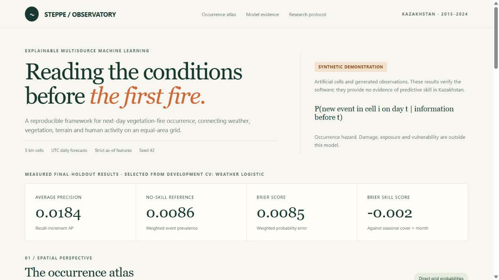

# Wildfire KZ · Steppe Observatory

**An Explainable Multisource ML Framework for Spatiotemporal Wildfire Risk Prediction and Mapping in Kazakhstan**

A reproducible Python research pipeline for **next-day new vegetation-fire occurrence hazard** on a 5 km equal-area grid. The historical project title retains “risk”; the implemented outcome contains no damage, exposure or vulnerability component.

```math
\hat p(i,t)=P(\text{first detection of a new connected event in cell }i\text{ on }t\mid x(i,<t)).
```

The local report combines an interactive daily cell atlas, measured model comparisons, reliability diagrams, TreeSHAP figures and an auditable experiment record. **Synthetic output verifies software behavior and is not evidence about Kazakhstan. No real-data model has been evaluated.**

## Start locally

Python 3.11 or newer is required. These commands work in PowerShell, bash and CI after activating the virtual environment:

```sh
python -m venv .venv
# PowerShell: .venv\Scripts\Activate.ps1
# bash: source .venv/bin/activate
python -m pip install -e ".[dev]"
python -m wildfire_kz synthetic
python -m wildfire_kz run-all -c configs/synthetic.yaml
python -m pytest -q
```

If the virtual environment was created without pip, `uv pip install --python .venv/Scripts/python.exe -e ".[dev]"` is an alternative on Windows. An internet connection is needed to install dependencies, but neither the synthetic pipeline nor tests access the network.

Open `runs/synthetic/report/index.html` in a browser. It is self-contained and works offline. GeoTIFFs are in `runs/synthetic/map/`; CSVs and paired intervals are in `runs/synthetic/evaluate/`. Treat joblib files as executable local artifacts: load only artifacts you trust.

The demonstration covers the same calendar years, model families, nested temporal validation and buffered spatial folds as the primary protocol. Its configuration explicitly reduces tuning trials, tree counts and bootstrap repetitions to exercise the full workflow quickly. `configs/primary.yaml` retains the requested research budgets. Do not use demonstration uncertainty estimates for scientific inference.

## Run the research protocol

Prepare observations using [the source contracts](docs/data_contracts.md), register source paths, versions, acquisition dates and optional expected checksums in `configs/primary.yaml`, then execute:

```sh
python -m wildfire_kz ingest -c configs/primary.yaml
python -m wildfire_kz grid -c configs/primary.yaml
python -m wildfire_kz events -c configs/primary.yaml
python -m wildfire_kz risk-set -c configs/primary.yaml
python -m wildfire_kz sampling -c configs/primary.yaml
python -m wildfire_kz features -c configs/primary.yaml
python -m wildfire_kz splits -c configs/primary.yaml
python -m wildfire_kz train -c configs/primary.yaml
python -m wildfire_kz calibrate -c configs/primary.yaml
python -m wildfire_kz ablate -c configs/primary.yaml
# This is the first command allowed to materialize test observations:
python -m wildfire_kz evaluate -c configs/primary.yaml
python -m wildfire_kz explain -c configs/primary.yaml
python -m wildfire_kz map -c configs/primary.yaml
python -m wildfire_kz report -c configs/primary.yaml
```

`run-all` is explicit authorization to execute the final holdout stage as part of a complete experiment. `--force` rebuilds a stage. Stage caches include configuration, source checksums, code content, upstream fingerprints and verified output hashes. Failed stages preserve the previous successful directory and leave diagnostics in the log. For an experiment with changed inputs or code, run `run-all` to rebuild the dependency chain.

Downloads are separate and optional: `python -m wildfire_kz download --help`. No credentials are embedded and no unavailable source is replaced with artificial data. NASA/ECMWF authentication, source-specific retrieval, reprojection and normalized source preparation are explicit prerequisites; this project does not pretend to include a downloaded national archive.

## Research design

* Suomi-NPP VIIRS standard-processed labels, categorical nominal/high confidence, connected events with one earliest positive, and development-only industrial exclusions.
* A past-only 48-hour risk-set exclusion. Later detections affect event grouping and eligibility history only.
* As-of joins record an availability timestamp for every nonmissing feature. Full MODIS intervals plus publication lag, preceding-year land cover, and dated human factors are enforced.
* Three rolling-origin development validations; separate five-fold spatial validation with full-block polygon buffers. Nested tuning occurs inside each outer training partition, with additional block-size sensitivity runs.
* Logistic regression, Random Forest, XGBoost and CatBoost share feature/split definitions. Weather-only logistic and smoothed seasonal cover × month frequencies are baselines. Weighted AP selects hyperparameters; calibration and operating thresholds use only the reserved year.
* Grouped ablations, paired space-time bootstrap intervals, prevalence, AP, ROC-AUC, threshold metrics, Brier/BSS, ECE, reliability counts/intervals, area-based alert burden and year/month/region/cover strata.
* TreeSHAP explains raw boosted-tree margins; its additive reconstruction is tested at runtime. Associations are explicitly noncausal. Direct cell rasterization preserves probabilities, nodata and calibration-frozen classes.

The CRS is Lambert azimuthal equal-area, centered at 48°N, 67°E, WGS84, metres. Lattice origin is (0,0); IDs encode resolution, row and column. Boundary cells are clipped and carry their actual area. A regional 1 km run is configured with its own boundary and `grid.resolution_m: 1000`; run it in a distinct output directory and regenerate cell-level inputs for that grid.

## Engineering and validation

```sh
ruff check .
ruff format --check .
mypy src/wildfire_kz
pytest -q
```

`Makefile` exposes the same commands. CI checks both supported minimum and development Python versions. Notebooks are for exploration only; the pipeline has no notebook dependency.

Raster input uses lazy xarray/Dask or windowed rasterio reads. Feature extraction runs by month and small cell batches; tables use year/month-partitioned Parquet. Fold-local two-pass reservoirs retain all positives and bounded negative samples, with exact inclusion probabilities. Representative evaluation data remain unbalanced; if they exceed a configured budget, probability sampling records weights. Boosting uses development-only early stopping and fixed selected iteration counts for the final refit. Class weighting is an explicit sensitivity configuration and retains the full training partition, so national-size feasibility depends on its row count; use a regional sensitivity run where needed. Hardware feasibility of the entire national archive must be measured on that archive.

Read [methodology mapping](docs/methodology_mapping.md), [assumptions and deviations](docs/deviations.md), and [the experiment protocol](docs/protocol.md) before interpreting any output. [Validation](docs/validation.md) records executed checks and their scope.


