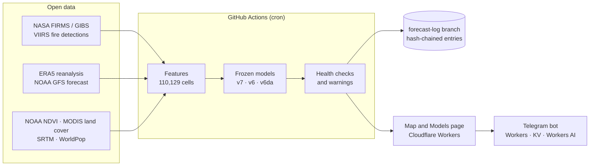

<div align="center">

# Steppe · Wildfire KZ

**Next-day wildfire forecasts for every 5 km of Kazakhstan, published every day.**

[](pyproject.toml)
[](docs/model-v7-progress.md)
[](docs/cloud-setup.md)
[](LICENSE)

[**Live map**](https://steppe-wildfire.wildf-kz.workers.dev) ·
[Models and issue log](https://steppe-wildfire.wildf-kz.workers.dev/reports/models.html) ·
[Operations](docs/operations.md) ·
[Paper results](docs/paper/results/README.md)

</div>

## What it is

Steppe estimates, for each of **110,129 cells** (5 × 5 km) in Kazakhstan, the probability that a
**new vegetation fire is first seen by satellite tomorrow** (one UTC day). It is two things in one
repository:

- **A research study.** A reproducible pipeline that builds the dataset from open sources, trains
  four model families against two simple references, and tests them on future years and unseen
  regions at the real fire rate (about 2 fires per 10,000 cell-days).
- **A running service.** GitHub Actions issue a forecast every night. The forecast goes to a
  hash-chained log, a public map in three languages (RU / EN / KK), and a Telegram bot with
  daily alerts and an AI assistant that answers only from the service's own data.

> [!IMPORTANT]
> Steppe is a research forecast of where a fire is *more likely*, not an official warning.
> In an emergency, call **112**.

## Results

**Research study** (frozen release, test years 2023–2024, 80 million cell-days, real fire rate):

| Model | Average precision | × random | ROC-AUC | Fires in daily top 5% of area |
|---|---:|---:|---:|---:|
| **XGBoost** | **0.0204** | **104** | **0.924** | **55.6%** |
| CatBoost | 0.0175 | 89 | 0.908 | 50.2% |
| Random Forest | 0.0070 | 36 | 0.879 | 49.2% |
| Logistic regression | 0.0010 | 5 | 0.793 | 25.6% |
| Seasonal frequency (reference) | 0.0006 | 3 | 0.731 | 14.3% |
| Weather-only logistic (reference) | 0.0004 | 2 | 0.662 | 8.4% |

- **Combined data help.** Starting from weather only and adding vegetation, land cover, terrain,
  human pressure and season raises AP from 0.0006 to 0.0234
  ([`forward_additions.csv`](docs/paper/results/tables/forward_additions.csv)).
- **Strong in time, weaker in space.** AP is 0.0192 in 2023 and 0.0277 in 2024, but 0.0039 in
  unseen 100 km regions.
- **Good ranking, high probabilities.** Warning levels order risk correctly. The top level covers
  5% of the area and holds 65.8% of new fires, but probabilities run 1.3–1.8× too high because
  fires became rarer after 2022.

95% intervals come from 1,000 paired space-time block bootstraps (100 km × 30 days). Every table
and figure is in [`docs/paper/results`](docs/paper/results/README.md).

## Models in service

| Model | Role | Issued (UTC) | Inputs | Fitted / calibrated |
|---|---|---|---|---|
| **v7** | default on map and bot | 23:05–05:35 on the target day | v6 inputs + fires to 21:00 the day before + GFS weather for the target day | 2015–2023 / isotonic on 2024–2025, alert threshold 4.5% |
| v6 | cell-history model | same morning run | 26 predictors, ERA5 7 days old, fire history of each cell | 2015–2021 / sigmoid on 2022 |
| v6da | tomorrow, issued in advance | from 12:05 the day before, on time before 19:00 | v6 recipe with ERA5 8 days old | 2015–2021 / sigmoid on 2022 |

On 2020–2025 development data, v7 beats the v6 recipe: AP 0.0213 against 0.0195, and recall
8.2% against 3.8% at equal precision ([details](docs/model-v7-progress.md)). Since November 2026,
NOAA-20 VIIRS fills any S-NPP outage longer than 24 hours, and each such issue is flagged in the
log (amendment 2026-11-05-01).

## How it works



- **No future leaks.** Every predictor is taken only from data that existed before the target day.
  Satellite fires are linked into events (2 km, 48 h), and only the first day of each event is
  counted as a new fire.
- **Auditable releases.** Models, calibrators and the scoring code are pinned by SHA-256 in
  `release.json` files, and each run refuses to start if anything differs. Log entries are
  hash-chained, and the first entry for a day is final.
- **Prospective test.** The frozen v6 and v7 are scored on 1 March – 31 October 2027 against fires
  that had not happened when the forecasts were written.

## Repository layout

```text
src/wildfire_kz/      research pipeline: grid, events, features, sampling, splits, models,
                      calibration, evaluation, SHAP, maps, forecast log
scripts/              model development (v5–v7), daily and day-ahead forecasts, asset builds,
                      paper figures and tables
platform/dist/        static website: map, Models page, archive reports (served as-is)
bot/                  Telegram bot on Cloudflare Workers (Node, no build step)
configs/              pipeline configurations (primary, synthetic)
docs/                 methods, protocol, operations, model notes, paper and poster
tests/                pytest suite      .github/workflows/  CI, nightly, day-ahead, bot
runs/                 frozen releases and experiment outputs (large files stay local)
```

## Quick start

Requires Python 3.11 or newer. The synthetic demo runs offline and exercises the whole pipeline.

```bash
python -m venv .venv
source .venv/bin/activate            # PowerShell: .venv\Scripts\Activate.ps1
python -m pip install -e ".[dev]"
python -m wildfire_kz synthetic
python -m wildfire_kz run-all -c configs/synthetic.yaml
```

Open `runs/synthetic/report/index.html`. The demo uses reduced budgets; do not use its numbers
for inference.

Preview the website locally:

```bash
python -m http.server 8770 --bind 127.0.0.1 --directory platform/dist
```

<details>
<summary><b>Reproduce the public-data study</b></summary>

Install the extra readers with `python -m pip install -e ".[dev,public]"`, then run:

```bash
python scripts/acquire_public_predictors.py weather --start-year 2014 --end-year 2022 --workers 1 --attempts 6
python scripts/acquire_public_predictors.py vegetation --start-year 2014 --end-year 2022 --workers 2 --attempts 6
python scripts/acquire_public_predictors.py landcover --start-year 2014 --end-year 2021 --workers 2 --attempts 6
python scripts/acquire_public_predictors.py terrain --workers 2 --attempts 6
python scripts/acquire_public_predictors.py human
python scripts/run_public_hindcast.py prepare
python scripts/audit_public_development.py
python scripts/run_public_hindcast.py compare --trials 5
python scripts/run_public_hindcast.py freeze        # seals models, calibration, thresholds
python scripts/run_public_hindcast.py acquire-final # first step that touches 2023-2024
python scripts/run_public_hindcast.py evaluate
python scripts/run_public_hindcast.py explain
python scripts/run_public_hindcast.py report
python scripts/run_public_hindcast.py export
```

Paper analyses: `scripts/paper_ablation.py` (remove one input group),
`scripts/paper_forward_additions.py` (add groups in turn), `scripts/article_figures.py`.
Method: [public-hindcast-method.md](docs/public-hindcast-method.md). Data status:
[real_data_status.md](docs/real_data_status.md).

</details>

<details>
<summary><b>Run the strict research protocol stage by stage</b></summary>

Prepare inputs per [data_contracts.md](docs/data_contracts.md), register them in
`configs/primary.yaml`, then run the stages in order (or `make all`):

```bash
for stage in ingest grid events risk-set sampling features splits train calibrate ablate \
             evaluate explain map report; do
  python -m wildfire_kz "$stage" -c configs/primary.yaml
done
```

`evaluate` is the first stage allowed to read test years. Stage caches key on configuration,
source checksums, code and upstream outputs; `--force` rebuilds a stage.

</details>

<details>
<summary><b>Run the daily forecast</b></summary>

In production the forecast runs on GitHub Actions; setup takes about 15 minutes on free tiers
([cloud-setup.md](docs/cloud-setup.md)).

| Workflow | Trigger | Does |
|---|---|---|
| `forecast.yml` | cron 23:05–05:35 UTC | issues v7 and v6, updates log, site and bot bulletin |
| `dayahead.yml` | cron 12:05–23:05 UTC | issues v6da for the next day |
| `bot.yml` | push to `bot/**` | tests and deploys the Telegram bot |
| `ci.yml` | push / pull request | lint, types, tests on Python 3.11 and 3.12, bot tests |

To run locally instead: `python scripts/forecast_daily.py`. Never run both, or two issuers race
for the same log. Full runbook: [operations.md](docs/operations.md).

</details>

## Data sources

| Data | Source | Resolution |
|---|---|---|
| Fire detections (target) | NASA FIRMS, VIIRS S-NPP (NOAA-20 for outages) | 375 m, daily |
| Weather | ERA5 reanalysis (via Open-Meteo), NOAA GFS forecast | 0.25°, daily |
| Vegetation | NOAA CDR NDVI | 0.05°, weekly |
| Land cover | MODIS MCD12Q1 | 500 m, yearly |
| Terrain | SRTM (CGIAR-CSI v4) | 90 m |
| People | WorldPop 2010, Natural Earth settlements | 1 km |

Only public data are downloaded, and nothing is uploaded. The FIRMS key and Cloudflare tokens live
in GitHub Actions secrets, never in the repository.

## Development

```bash
make check                 # ruff check, ruff format --check, mypy, pytest
cd bot && npm test         # bot unit tests (node --test)
```

Files listed under `extend-exclude` in `pyproject.toml` are pinned by hash in frozen releases.
Do not reformat or edit them; change behaviour through a new release instead.

## Limitations

- The target is the first satellite detection, not the true ignition time. Farm burning is
  included with wildfires.
- Week-old reanalysis weather misses short dry spells; v7 addresses this with GFS forecasts.
- Transfer to regions not seen in training is weak, and forest fires are too rare at 5 km to
  evaluate on their own.
- Probabilities rank cells well but are not exact chances. Use the warning levels as an order of
  risk.

Read [methodology_mapping.md](docs/methodology_mapping.md), [deviations.md](docs/deviations.md)
and [protocol.md](docs/protocol.md) before interpreting any output.

## Documentation

| Topic | Document |
|---|---|
| Final report (RU) | [final-report.md](docs/final-report.md) |
| Experiment protocol and checks | [protocol.md](docs/protocol.md) · [validation.md](docs/validation.md) |
| Models | [model-v6.md](docs/model-v6.md) · [model-v6da.md](docs/model-v6da.md) · [model-v7-progress.md](docs/model-v7-progress.md) |
| Data quality | [source-quality-verification.md](docs/source-quality-verification.md) |
| Cloud setup and operations | [cloud-setup.md](docs/cloud-setup.md) · [operations.md](docs/operations.md) |
| Website | [platform/README.md](platform/README.md) |

## Citation

```bibtex
@unpublished{zharylkap2026steppe,
  author = {Zharylkap, Samat and Bolarbek, Nurbek},
  title  = {An Explainable Multisource Machine Learning Framework for Spatiotemporal
            Wildfire Risk Prediction and Mapping in {Kazakhstan}},
  note   = {Research manuscript, Astana IT University},
  year   = {2026}
}
```

## Authors and license

Samat Zharylkap and Nurbek Bolarbek, School of Data Science and Artificial Intelligence,
Astana IT University. Parts of the code, analysis and documentation were written with the help of
an AI assistant (Claude, Anthropic); the authors reviewed them.

Released under the [MIT License](LICENSE).
