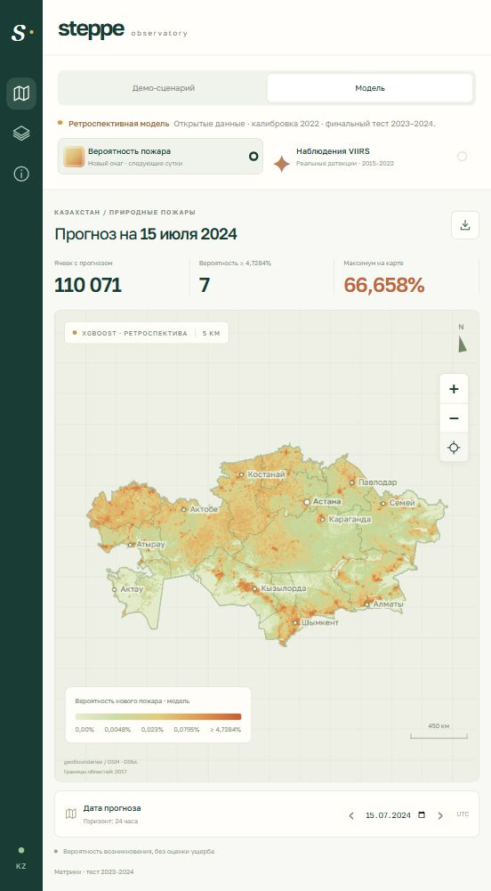

# Wildfire KZ · Steppe Observatory

**An Explainable Multisource ML Framework for Spatiotemporal Wildfire Risk Prediction and Mapping in Kazakhstan**

A reproducible Python research pipeline for **next-day new vegetation-fire occurrence hazard** on a 5 km equal-area grid. The historical project title retains “risk”; the implemented outcome contains no damage, exposure or vulnerability component.

```math
\hat p(i,t)=P(\text{first detection of a new connected event in cell }i\text{ on }t\mid x(i,<t)).
```

The local report combines an interactive daily cell atlas, measured model comparisons, reliability diagrams, TreeSHAP figures and an auditable experiment record. The public-data experiment has completed real final evaluation on 2023–2024. Synthetic output remains a separate software demonstration.

## Start locally

Python 3.11 or newer is required. These commands work in PowerShell, bash and CI after activating the virtual environment:

```sh
python -m venv .venv
# PowerShell: .venv\Scripts\Activate.ps1
# bash: source .venv/bin/activate
python -m pip install -e ".[dev]"
python -m wildfire_kz synthetic
python -m wildfire_kz run-all -c configs/synthetic.yaml
python -m pytest -q
```

If the virtual environment was created without pip, `uv pip install --python .venv/Scripts/python.exe -e ".[dev]"` is an alternative on Windows. An internet connection is needed to install dependencies, but neither the synthetic pipeline nor tests access the network.

Open `runs/synthetic/report/index.html` in a browser. It is self-contained and works offline. GeoTIFFs are in `runs/synthetic/map/`; CSVs and paired intervals are in `runs/synthetic/evaluate/`. Treat joblib files as executable local artifacts: load only artifacts you trust.

The demonstration covers the same calendar years, model families, nested temporal validation and buffered spatial folds as the primary protocol. Its configuration explicitly reduces tuning trials, tree counts and bootstrap repetitions to exercise the full workflow quickly. `configs/primary.yaml` retains the requested research budgets. Do not use demonstration uncertainty estimates for scientific inference.

The separate public-data hindcast trained six model families, selected XGBoost
on rolling 2019–2021 validation, calibrated on 2022, and froze the release before
opening 2023–2024 for final evaluation. See the
[actual acquisition status](docs/real_data_status.md). The primary pipeline's original source contracts
remain separate; its preflight still requires its own compatible input tables.
The synthetic report above remains a demonstration.

## Public-data hindcast runner

The authorised [public alternative](docs/public-hindcast-method.md) uses actual
ERA5, NOAA VIIRS NDVI, MCD12Q1, SRTM, WorldPop and dated settlement data. It has
its own compact feature tables and output directory, `runs/public_hindcast`.
The strict primary configuration above retains its original source contracts.
Install the additional readers with `python -m pip install -e ".[dev,public]"`.

After registering the boundary and development/calibration VIIRS partitions:

```sh
python scripts/acquire_public_predictors.py weather --start-year 2014 --end-year 2022 --workers 1 --attempts 6
python scripts/acquire_public_predictors.py vegetation --start-year 2014 --end-year 2022 --workers 2 --attempts 6
python scripts/acquire_public_predictors.py landcover --start-year 2014 --end-year 2021 --workers 2 --attempts 6
python scripts/acquire_public_predictors.py terrain --workers 2 --attempts 6
python scripts/acquire_public_predictors.py human
python scripts/run_public_hindcast.py prepare
python scripts/audit_public_development.py
python scripts/run_public_hindcast.py compare --trials 5
python scripts/run_public_hindcast.py freeze
python scripts/run_public_hindcast.py acquire-final
python scripts/run_public_hindcast.py evaluate
python scripts/run_public_hindcast.py explain
python scripts/run_public_hindcast.py report
python scripts/run_public_hindcast.py export
```

`scripts/complete_public_hindcast.py` runs the prepared sequence and can wait for
an existing comparison with `--wait-training-pid PID`. Use one coordinator per
experiment. SQLite retains tuning attempts; a released experiment refuses new
tuning. Calibration, thresholds, model artifacts and the evaluation implementation
are sealed before final-year materialisation.

On 22 October the user reduced the search budget to five attempts. The existing
random-forest trial history is retained rather than discarded. The pre-test
amendment checks unchanged scientific inputs and fitting code; it is recorded
in `runs/public_hindcast/budget_amendment.json` with the original protocol archived
alongside it. Different search effort is disclosed in the final report.

If the provider's autumn-2023 soil containers are absent, retain the frozen release
and recover the same ERA5 observations through its official free API:

```sh
python scripts/openmeteo_soil_api.py
```

In another terminal, `python scripts/acquire_2023_weather_recovery.py` prefetches
the other native fields and waits for verified soil observations. Use one API
downloader; it persists the quota budget and resumes saved responses. After both
commands succeed, resume `python scripts/complete_public_hindcast.py`. No
retraining is involved. See the documented [source recovery](docs/source-quality-verification.md#final-year-supplier-gap-and-original-provider-recovery).

Final evaluation checks 2023–2024 after that release. It records design-weighted
metrics, year/month/region/cover strata, 1,000 paired cluster resamples and
calibration uncertainty. Explanations use the estimator's correct uncalibrated
output unit: boosted-tree/linear log-odds, RF probability. RF/XGBoost use
TreeSHAP; CatBoost uses explicitly approximate permutation SHAP with a
training-only background because native Lossguide SHAP failed a pre-test
[compatibility check](docs/explanation-compatibility.md). These are predictive
associations. The map export verifies all 731 dates, exact browser/GeoTIFF
probability agreement, frozen class bands and full-grid alert burden.

The final report is `runs/public_hindcast/report/index.html`; daily two-band
GeoTIFFs are in `runs/public_hindcast/maps`. The website consumes verified
float32 probability assets and the actual evaluation JSON. [Source-quality
evidence](docs/source-quality-verification.md) documents native QA metadata,
storage compaction and final-only year-boundary completion. This practical run
does not claim the primary study's full nested spatial/sensitivity/ablation suite.

The real final sample contains 345,954 rows and 15,704 positive cell-days,
representing 80,081,865 eligible cell-days through design weights. XGBoost's
weighted AP is **0.0204455** (95% cluster interval 0.0166236–0.0311414),
ROC-AUC **0.9236848**, and Brier **0.000196064**. At its unchanged 2022 threshold
0.0472837, precision is 0.0976085 and recall 0.0516429. The positive prevalence
is 0.000196099. These are retrospective results, not operational validation;
the fixed threshold misses most events. XGBoost's paired AP difference from
CatBoost has an interval spanning zero. Exact six-model metrics and intervals
remain in `runs/public_hindcast/evaluate/` and the generated report.

## Run the research protocol

Prepare observations using [the source contracts](docs/data_contracts.md), register source paths, versions, acquisition dates and optional expected checksums in `configs/primary.yaml`, then execute:

```sh
python -m wildfire_kz ingest -c configs/primary.yaml
python -m wildfire_kz grid -c configs/primary.yaml
python -m wildfire_kz events -c configs/primary.yaml
python -m wildfire_kz risk-set -c configs/primary.yaml
python -m wildfire_kz sampling -c configs/primary.yaml
python -m wildfire_kz features -c configs/primary.yaml
python -m wildfire_kz splits -c configs/primary.yaml
python -m wildfire_kz train -c configs/primary.yaml
python -m wildfire_kz calibrate -c configs/primary.yaml
python -m wildfire_kz ablate -c configs/primary.yaml
# This is the first command allowed to materialize test observations:
python -m wildfire_kz evaluate -c configs/primary.yaml
python -m wildfire_kz explain -c configs/primary.yaml
python -m wildfire_kz map -c configs/primary.yaml
python -m wildfire_kz report -c configs/primary.yaml
```

`run-all` is explicit authorization to execute the final holdout stage as part of a complete experiment. `--force` rebuilds a stage. Stage caches include configuration, source checksums, code content, upstream fingerprints and verified output hashes. Failed stages preserve the previous successful directory and leave diagnostics in the log. For an experiment with changed inputs or code, run `run-all` to rebuild the dependency chain.

Downloads are separate and optional: `python -m wildfire_kz download --help`. No credentials are embedded and no unavailable source is replaced with artificial data. NASA/ECMWF authentication, source-specific retrieval, reprojection and normalized source preparation are explicit prerequisites; this project does not pretend to include a downloaded national archive.

## Research design

* Suomi-NPP VIIRS standard-processed labels, categorical nominal/high confidence, connected events with one earliest positive, and development-only industrial exclusions.
* A past-only 48-hour risk-set exclusion. Later detections affect event grouping and eligibility history only.
* As-of joins record an availability timestamp for every nonmissing feature. Full MODIS intervals plus publication lag, preceding-year land cover, and dated human factors are enforced.
* Three rolling-origin development validations; separate five-fold spatial validation with full-block polygon buffers. Nested tuning occurs inside each outer training partition, with additional block-size sensitivity runs.
* Logistic regression, Random Forest, XGBoost and CatBoost share feature/split definitions. Weather-only logistic and smoothed seasonal cover × month frequencies are baselines. Weighted AP selects hyperparameters; calibration and operating thresholds use only the reserved year.
* Grouped ablations, paired space-time bootstrap intervals, prevalence, AP, ROC-AUC, threshold metrics, Brier/BSS, ECE, reliability counts/intervals, area-based alert burden and year/month/region/cover strata.
* TreeSHAP explains raw boosted-tree margins; its additive reconstruction is tested at runtime. Associations are explicitly noncausal. Direct cell rasterization preserves probabilities, nodata and calibration-frozen classes.

The CRS is Lambert azimuthal equal-area, centered at 48°N, 67°E, WGS84, metres. Lattice origin is (0,0); IDs encode resolution, row and column. Boundary cells are clipped and carry their actual area. A regional 1 km run is configured with its own boundary and `grid.resolution_m: 1000`; run it in a distinct output directory and regenerate cell-level inputs for that grid.

## Engineering and validation

```sh
ruff check .
ruff format --check .
mypy src/wildfire_kz
pytest -q
```

`Makefile` exposes the same commands. CI checks both supported minimum and development Python versions. Notebooks are for exploration only; the pipeline has no notebook dependency.

Raster input uses lazy xarray/Dask or windowed rasterio reads. Feature extraction runs by month and small cell batches; tables use year/month-partitioned Parquet. Fold-local two-pass reservoirs retain all positives and bounded negative samples, with exact inclusion probabilities. Representative evaluation data remain unbalanced; if they exceed a configured budget, probability sampling records weights. Boosting uses development-only early stopping and fixed selected iteration counts for the final refit. Class weighting is an explicit sensitivity configuration and retains the full training partition, so national-size feasibility depends on its row count; use a regional sensitivity run where needed. Hardware feasibility of the entire national archive must be measured on that archive.

Read [methodology mapping](docs/methodology_mapping.md), [assumptions and deviations](docs/deviations.md), and [the experiment protocol](docs/protocol.md) before interpreting any output. [Validation](docs/validation.md) records executed checks and their scope.

## Interactive Kazakhstan map platform

The [Steppe platform](platform/README.md) adds an interactive actual national
map, daily demonstration scenarios, cell details, region search, CSV export,
and genuine 2015–2022 VIIRS observation layers. Run:

```powershell
.venv\Scripts\python.exe -m http.server 8770 --bind 127.0.0.1 --directory platform\dist
```

Open http://127.0.0.1:8770/. The default layer now loads the frozen, evaluated
XGBoost probabilities for 2024-07-15. All 731 dates in 2023–2024 passed the
independent browser/GeoTIFF check; three dates correctly contain only nodata.
The date control, cell cards, calibration threshold, CSV and results dialog use
actual model outputs. The explicitly labelled demonstration remains an optional
separate mode. The original strict-pipeline raster adapter remains available as
`scripts/export_platform_forecast.py`.


