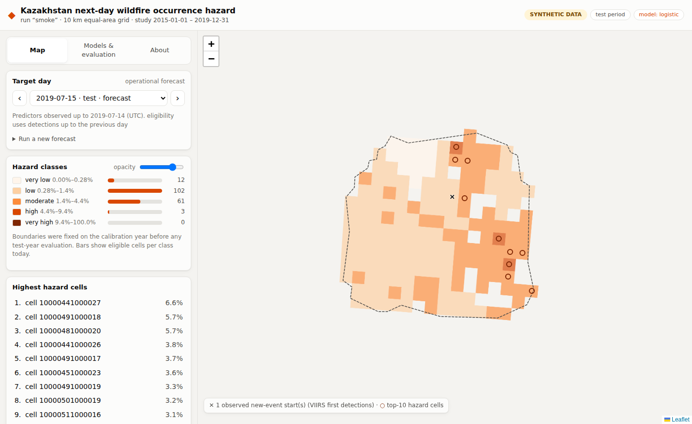

# Platform

The platform turns pipeline artifacts into an operational service: a web map of daily
next-day hazard, per-cell drill-down with model drivers, a production-model card, and an
API that can run new forecasts.

```
            pipeline stages (train → calibrate → evaluate → map)
                                   │ artifacts
                                   ▼
   wildfire-kz forecast ──► ForecastEngine (forecast/engine.py) ◄── FastAPI (platform/api.py)
     (operational day)        production model + frozen Platt +          │
                              frozen class boundaries                      ▼
                                                           static web UI (Leaflet, vendored)
```

## The production ("best") model

* **Candidates:** L2 logistic regression, Random Forest, XGBoost, CatBoost, plus an extra
  candidate `ensemble_trees`, the mean of the XGBoost and CatBoost uncalibrated log-odds
  (`models.ensemble`). Baselines and class-weight sensitivity variants are never promoted.
* **Selection rule:** the highest mean weighted average precision over the rolling-origin
  **development** validation years (`selection.json → production_model`). The ensemble is
  scored on the same folds with the same procedure. Calibration and test years are never
  used to choose the model. Choosing on test data would make the reported test performance
  optimistic, and the platform's displayed metrics would stop being an honest estimate.
* **What "best" means here:** best by the pre-registered criterion. On real data any
  candidate can win, including logistic regression. On the synthetic smoke data the
  logistic model wins. The model card shows every candidate's development score next to
  its (later) test score, so the choice is transparent.
* The production model is calibrated (Platt, calibration year) and mapped with the class
  boundaries frozen before testing, exactly like the research pipeline.

## Explanations in the UI

Clicking a cell shows the top additive contributions to the model's **uncalibrated
log-odds score** (`explain/contributions.py`):

| production model | method | exact? |
|---|---|---|
| XGBoost / CatBoost | TreeSHAP, raw margin | yes (additive) |
| ensemble_trees | mean of members' TreeSHAP | yes (the score is the mean of member log-odds) |
| logistic | coefficient × standardised value | yes, relative to the training mean |
| Random Forest | TreeSHAP, probability scale | additive on probability, labelled as such |

These are predictive associations of the model, not causes. This is stated in the UI and in
every API response.

## Forecasts

`wildfire-kz forecast YYYY-MM-DD` (or `POST /api/forecast?date=…`) predicts for target day
*t* using information up to *t−1*:

* features come from the same `FeatureBuilder` (as-of rules and leakage guarantees apply);
  for days after the study period, land cover and population for the new year are derived
  on demand from the preceding-year products (never later ones);
* cells with a detection in the previous 48 h are shown as not eligible (transparent). If the
  detection archive does not reach *t−1*, the forecast metadata carries an explicit warning;
* outputs go to `<run>/<grid>/forecast/YYYYMMDD/`: `prob_*.tif`, `class_*.tif` (+ `.qml`),
  `cells_*.parquet`, `meta_*.json`;
* **protocol guard:** a forecast for a day inside the test years is refused until the final
  evaluation has been run, so test-period maps cannot be inspected before evaluation.

For true operational use, append new FIRMS detections, ERA5-Land months and MODIS composites
to `data/raw`, re-run `ingest` and `events` (labels and recent-fire eligibility), then run
`forecast` for tomorrow. Models do not need retraining for this.

## API

| method | path | description |
|---|---|---|
| GET | `/api/health` | status, run label, completed stages, synthetic flag |
| GET | `/api/config` | UI settings (title, colours, basemap, disclaimer) |
| GET | `/api/model` | production model card (selection, calibration, τ, test metrics) |
| GET | `/api/models` | every candidate: development AP, test metrics after evaluation |
| GET | `/api/evaluation` | reliability, capture rates and generated result flags |
| GET | `/api/days` | available days (pipeline maps and forecasts) |
| GET | `/api/days/{date}` | day summary: bounds, class counts, observed new events |
| GET | `/api/days/{date}/overlay.png` | class raster warped to Web Mercator (RGBA) |
| GET | `/api/days/{date}/prob.tif` | calibrated-probability GeoTIFF download |
| GET | `/api/days/{date}/top?n=` | highest-hazard eligible cells |
| GET | `/api/days/{date}/cell?lat=&lon=` | cell probability, class, observed outcome, drivers |
| GET | `/api/boundary` | country outline (GeoJSON) |
| POST | `/api/forecast?date=` | run the production model for a target day |

Interactive OpenAPI docs: `/docs`.



## Static snapshot

`wildfire-kz export-site --out snapshot.html` writes one self-contained HTML file (overlays,
per-cell probabilities and drivers, model card) for calibration- and test-year fire seasons.
It can be shared where running a server is not possible.

## Running

```bash
pip install -e ".[platform]"
make platform-demo                                   # synthetic smoke run + server on :8000
wildfire-kz serve -c configs/default.yaml --port 8000
docker compose up platform                           # mounts ./data
docker compose run --rm pipeline forecast 2025-07-15 -c configs/default.yaml
```

Leaflet is vendored (`platform/static/vendor/leaflet`, BSD-2-Clause, SRI-checked), so the UI
works on networks without CDN access. The background map uses OpenStreetMap tiles by
default; set `platform.basemap_url: ""` for fully offline use (the country outline is still
drawn from the configured boundary).
